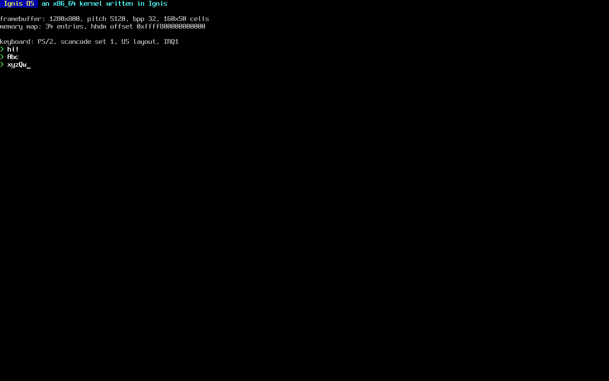

# IgniOS

A Unix-like x86_64 kernel written in [Ignis](https://github.com/Ignis-lang/ignis), booted by Limine on UEFI.

IgniOS is the first large Ignis program that lives outside the compiler. It doubles as a test bench: when the kernel hits a compiler bug, the bug is fixed in the compiler rather than worked around here. Volatile access, freestanding builds, C-layout records, C function pointers and Intel-syntax inline asm all landed in Ignis because this kernel needed them.



## Status

Early, and only tested in QEMU with OVMF.

| Area | State |
|---|---|
| Boot | Limine (base revision 6) on UEFI, higher-half ELF at `0xffffffff80000000` |
| Console | Framebuffer text console, Spleen 8x16 font, 16 ANSI colors, cursor, scrolling; mirrored to COM1 |
| CPU | Own GDT and TSS (IST stack for double faults), IDT with exception reports; x87 and SSE enabled with per-thread FXSAVE state; SMEP and SMAP on when the CPU has them; per-CPU data behind the GS base with `swapgs` |
| Interrupts | ACPI MADT parsed; keyboard routed through the IOAPIC to vector 0x21 with local APIC end of interrupt; 8259 remapped to 0x20-0x2F and fully masked; idle loop sleeps with `sti; hlt` |
| Timer | Local APIC timer calibrated against PIT channel 2, periodic 100 Hz tick on vector 0x30; `uptime` at the prompt prints the time since boot |
| Threads | Kernel threads with their own stacks and a guard page, a round-robin run queue, `yield`, `sleep`, `exit` and `join`, an idle thread, and preemption by the timer tick with 100 ms time slices; `ps` lists the threads and `threads` starts a demo; the boot thread runs the terminal |
| Input | PS/2 keyboard, scancode set 1, US layout, Shift and Caps Lock, line editing at a `>` prompt |
| Memory | Bitmap frame allocator over the Limine memory map (4 KiB frames and 2 MiB runs, frees of unmanaged frames rejected); own 4-level page tables (kernel image per segment with W^X, direct map with 2 MiB pages, write-combining framebuffer, NX and write protection on); kernel heap in the higher half behind the compiler's allocation handlers |
| User mode | Per-process address spaces (own PML4, shared kernel half, U/S pages, frames freed on exit); ring 3 entered with `iretq`, left through `SYSCALL`/`SYSRET` or an interrupt (TSS.RSP0 follows the running thread); a Linux x86_64 syscall subset (`read`, `write`, `openat`, `close`, `lseek`, `fstat`, `newfstatat`, `getdents64`, `mkdirat`, `unlinkat`, `chdir`, `getcwd`, `reboot`, `mmap`, `munmap`, `exit`, `exit_group`, `getpid`, `sched_yield`, `nanosleep`, `-ENOSYS` for the rest) behind a per-process ABI table; every user pointer validated before use; a static ELF64 loader that starts programs from the file tree with argc and argv; a fault, privileged instruction or undefined instruction in ring 3 kills only that process; waiting for a process blocks until it is gone |
| Keyboard input | Programs read lines from descriptor 0: echo, Backspace, Enter, Ctrl+D for the end of input, shared with the kernel terminal |
| Files | A ustar initramfs loaded by Limine and checked at boot; an in-memory file tree seeded from it with copy on write, `/dev/console`, path rules as on Linux; per-process descriptor tables (16 entries growing to 256, 0 to 2 on the console) and current directories; nothing is saved across reboots |
| Shell | `/bin/sh`, a user program the kernel starts after the boot: it runs programs with spawn and wait and has `cd` and `exit`; Ctrl+D or `exit` hands the keyboard back to the kernel terminal (`uptime`, `ps`, `threads`, `run`) |
| Commands | `cat`, `ls`, `touch`, `mkdir`, `rm`, `rmdir`, `pwd`, `reboot` and `shutdown` in `/bin`, written in Ignis on the native IgniOS ABI |
| Memory mappings | `mmap` of anonymous memory and private copies of files, `munmap` that trims and splits regions, `PROT_READ`/`PROT_WRITE`/`PROT_EXEC`/`PROT_NONE` enforced by the page tables, write with execute refused; up to 1024 regions per process in a table that grows; `std::alloc`, a user heap on `mmap` behind the compiler's allocation hooks; `cat` reads files through `mmap` |
| Native ABI | A second system call ABI next to Linux, chosen per program by an `IgniOS` ELF note: own call numbers (22 calls: files, directories, the current directory, memory, process creation and waiting, scheduling, power), the status in RAX and the value in RDX, a published table of status codes, paths as pointer and length; both ABIs share descriptors and the checked transfers of `Syscall::Core`; `hello`, `cat`, `ls`, `touch` and `mkdir` are native programs, `fstest` and `mmtest` keep testing the Linux layer |
| Next | redirections and pipes in the shell; demand paging; more than one processor |

## Quick start

You need Nix with flakes. The flake provides clang, lld, Limine, QEMU, OVMF, mtools and the font.

```sh
nix develop
make run
```

With [direnv](https://direnv.net) and nix-direnv, the repository's `.envrc` loads the same shell when you enter the directory. Allow it once, then `make run` works without `nix develop`:

```sh
direnv allow
make run
```

QEMU opens a window. Click it to give it the keyboard and type at the prompt: `ls /`, `cat /etc/motd`, `mkdir /tmp`, `touch /tmp/a`, `ls /tmp`. The prompt is `/bin/sh`: `cd /etc`, `pwd`, `rm`, `rmdir` work as on Unix, `cat` alone copies what you type until Ctrl+D. `reboot` boots the machine again and `shutdown` powers it off, which closes QEMU. The programs are in `/bin`, and the files you create live in memory until the next boot. The terminal shows the serial log.

The build also needs an Ignis compiler with freestanding support (Ignis `main` from October 2026 or later). The Makefile uses the `ignis` on your `PATH`; point elsewhere with `make IGNIS=/path/to/ignis`.

## Make targets

| Target | What it does |
|---|---|
| `kernel` | Builds `build/kernel.elf` |
| `user` | Builds the user programs `build/user/NAME.elf` from `user/NAME`, `user/lib` and the entry stub `user/lib/linux/start.S` |
| `image` | Builds `build/ignios.img`, a FAT32 EFI system partition with Limine, the kernel and the initramfs |
| `run` | Boots in QEMU with the serial console on stdio |
| `run-headless` | Boots without a display and checks the banner, the prompt and the lines of `hello` in `build/serial.log` |
| `screenshot` | Boots headless and saves the screen to `build/screen.png` |
| `keytest` | Types keys through the QEMU monitor and checks the echo |
| `shelltest` | Types a session of `cat`, `ls`, `touch` and `mkdir`, their errors included, and checks every line they print |
| `powertest` | Types `reboot`, waits for the second boot, types `shutdown` and checks that QEMU exits by itself |
| `font` | Regenerates `kernel/src/drivers/font_8x16.ign` from the Spleen package |
| `clean` | Removes `build/` |

## How it is built

Ignis compiles the whole kernel to one C unit, which clang compiles for `x86_64-unknown-none` with kernel flags (no red zone, no SSE in the kernel, `-mcmodel=kernel`). The few routines that cannot be written in Ignis are small `.S` files under `kernel/src/arch/x86_64/`: interrupt entry stubs, the code segment reload, the stack switch, the ring 3 entry and the `SYSCALL` stub, the per-CPU block, the fault probes, and the throwaway user programs of the boot self-tests. `ld.lld` links everything with `kernel/linker.ld`, and `mtools` writes the boot image. No cross GCC is involved.

User programs are Ignis projects under `user/` built with `std = false` and the small user standard library in `user/lib`, shared code in `common/` and one `sys` per system call ABI in `linux/` and `native/` (`std::sys` wraps the system calls in inline asm, `std::io` prints, `std::args` reads argv, `std::alloc` is a heap on `mmap`, `std::panic` is the shared panic handler). The Makefile links each one after the entry stub `user/lib/linux/start.S` with `user/user.ld` into a static ELF64 at `0x400000` and packs it into the initramfs as `/bin/NAME`. The kernel runs `hello one two` at boot, before the keyboard line, and `run hello` at the prompt runs it again; `run PROGRAM ARG...` passes arguments.

## Layout

New to the code? [docs/READING.md](docs/READING.md) is a reading guide in the order the code runs, with a virtual address space map and the boot log explained line by line.

The kernel is split into subsystems. Each one is a directory under `kernel/src/` with a `mod.ign` facade, a namespace with the same name, and an import alias in `ignis.toml` (`import Mm from "@mm"`). Other subsystems import only the facade and call `Mm::Pmm::allocateFrame()`. The `//!` header of every `mod.ign` has the public API and the dependencies of its subsystem.

| Directory | Namespace | Alias | What is in it |
|---|---|---|---|
| `kernel/src/lib/` | `Lib` | `@lib` | `memcpy` and friends, integer formatting, the scancode ring buffer |
| `kernel/src/arch/` | `Arch` | `@arch` | CPU instructions, port I/O, GDT, IDT, PIC, PIT, context switch, ring 3 entry, the interrupt frame, x87/SSE state, SMEP/SMAP and fault probes, per-CPU data, all `.S` files (in `arch/x86_64/`) |
| `kernel/src/boot/` | `Boot` | `@boot` | Limine requests and responses, the higher half direct map |
| `kernel/src/drivers/` | `Drivers` | `@drivers` | COM1, the framebuffer console and its font, the PS/2 controller, the keyboard decoder |
| `kernel/src/acpi/` | `Acpi` | `@acpi` | RSDP, XSDT/RSDT, MADT and FADT parsing, the S5 sleep type |
| `kernel/src/mm/` | `Mm` | `@mm` | physical frames, page tables, address spaces, the kernel heap, Limine modules |
| `kernel/src/fs/` | `Fs` | `@fs` | the initramfs (ustar) and the in-memory file tree |
| `kernel/src/apic/` | `Apic` | `@apic` | local APIC and IOAPIC |
| `kernel/src/time/` | `Time` | `@time` | APIC timer calibration, the tick counter, uptime |
| `kernel/src/sched/` | `Sched` | `@sched` | the thread table and stacks, the run queue, sleep and timer preemption |
| `kernel/src/proc/` | `Proc` | `@proc` | process table, ELF loader, running a program from a path with arguments |
| `kernel/src/power/` | `Power` | `@power` | ACPI power-off (S5) and reset |
| `kernel/src/syscall/` | `Syscall` | `@syscall` | dispatch, the kernel operations, the Linux ABI table and handlers |
| `kernel/src/trap/` | `Trap` | `@trap` | the interrupt dispatcher, exception reports, GDT/IDT/`SYSCALL` setup with their log lines |
| `kernel/src/shell/` | `Shell` | `@shell` | the terminal loop and its commands |
| `kernel/src/tests/` | `Tests` | `@tests` | boot self-tests |
| `kernel/src/main.ign` | | | `kmain`: the boot order, one call per step |
| `kernel/src/panic.ign` | | | the panic handler |

The dependencies run one way, and the compiler rejects an import cycle. `Lib`, `Arch` and `Boot` import nothing else in the kernel, and each later subsystem imports only the ones before it. The table in [docs/READING.md](docs/READING.md) lists what every subsystem imports and why.

```
kernel/linker.ld               higher-half layout
user/lib/                      the user standard library (entry stub, syscalls, text output, argv)
user/hello/                    the first user program
user/sh/                       the shell
user/cat, ls, touch, mkdir, rm, rmdir, pwd/  the commands
user/reboot, shutdown/         reset and power off
user/fstest/                   ring 3 checks of the file system calls
user/mmtest/                   ring 3 checks of mmap, munmap and std::alloc
user/nativetest/               ring 3 checks of the native ABI
user/user.ld                   user program layout
initramfs/                     files packed into the initramfs next to the programs in /bin
boot/limine.conf               boot entry and the initramfs module
docs/READING.md                reading guide: subsystem by subsystem, address space map, annotated boot log
scripts/                       font generator, screenshot and key test drivers
```

## Acknowledgements

The overall approach (Limine, one generated C unit, clang and lld, assembly entry stubs) follows [Vinix](https://github.com/vlang/vinix), the operating system written in V.

## License

GPL-3.0-only, the same as the Ignis compiler. See `LICENSE`.

The console font is Spleen 8x16 by Frederic Cambus, under the BSD 2-Clause license. See `THIRD_PARTY.md` and `LICENSES/`.
